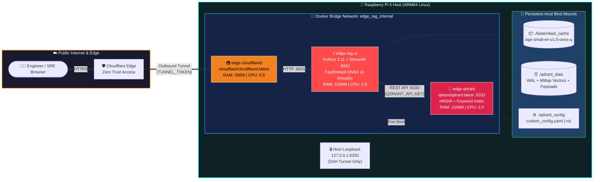

<div align="center">


[-C51A4A?style=for-the-badge&logo=raspberrypi&logoColor=white)](https://www.raspberrypi.com/)
[](https://www.python.org/)
[](https://streamlit.io/)
[-DC244C?style=for-the-badge&logo=rust&logoColor=white)](https://qdrant.tech/)
[-00B4D8?style=for-the-badge&logo=onnx&logoColor=white)](https://github.com/qdrant/fastembed)
[-8A2BE2?style=for-the-badge&logo=huggingface&logoColor=white)](https://huggingface.co/BAAI/bge-small-en-v1.5)
[](https://docs.docker.com/compose/)
[](https://www.cloudflare.com/zero-trust/)
[-2EA043?style=for-the-badge&logo=linux&logoColor=white)](#%EF%B8%8F-security--zero-trust-posture)

<br />

**A low-latency, memory- disciplined Semantic Search & Retrieval-Augmented Generation (RAG) Knowledge Hub engineered specifically for constrained ARM64 edge hardware.**

[✨ Overview](#-executive-overview) •
[🏗️ Architecture](#%EF%B8%8F-system-architecture--data-flow) •
[📂 Repository Map](#-repository-structure) •
[⚙️ Tech & Vector Specs](#%EF%B8%8F-vector-engine--embedding-specifications) •
[🖥️ UI Features](#%EF%B8%8F-application-capabilities--ui-tour) •
[🚀 Quick Start](#-deployment--operations) •
[🔍 Due Diligence Audit](#-technical-due-diligence--codebase-audit)

</div>

---

## ✨ Executive Overview

**Edge RAG Hub** is a self-contained, three-service microservice stack designed to index, manage, and semantically search technical runbooks, NOC/SRE incident playbooks, and engineering documentation directly on a **Raspberry Pi 5 (ARM64)** without relying on external GPU clusters or paid third-party embedding APIs.

> [!TIP]
> **Why ONNX + Rust on Edge?** Standard PyTorch + Transformer stacks easily consume `4 GB+` of RAM just to load runtime dependencies. By pairing **FastEmbed's quantized ONNX runtime** (`qdrant/bge-small-en-v1.5-onnx-q`) with **Qdrant's Rust engine** configured for `on_disk_payload` and memory-mapped segments, the entire stack operates comfortably inside a strict **3.25 GB RAM** and **4.5 CPU** ceiling.

### 🎯 Core Highlights

| Pillar | Implementation | Edge Benefit |
| :--- | :--- | :--- |
| 🧠 **Local CPU Vectorization** | `FastEmbed 0.4.2` + Quantized `BAAI/bge-small-en-v1.5` (`threads=4`) | Sub-50ms CPU query embeddings with zero external API cost or data egress |
| ⚡ **Rust HNSW Vector Engine** | `qdrant/qdrant:latest` with `Cosine` distance & `KEYWORD` payload indexing | Millisecond filtered similarity search with low memory footprint |
| 💾 **Flash/RAM Optimization** | `on_disk_payload: true` + `20 MB` `mmap` threshold + hard Docker cgroup caps | Prevents Linux OOM-killer events on 4 GB / 8 GB Raspberry Pi nodes |
| 🛡️ **Zero Public Port Exposure** | Outbound-only `cloudflared` tunnel + internal Docker bridge network | No port forwarding (`80`/`443`/`8501`) on the edge router; Qdrant bound to `127.0.0.1` |
| 🎛️ **Interactive Knowledge Ops** | Streamlit 3-tab console with live telemetry, category management, & JSON payload inspector | Real-time observability into embedding latency, HNSW lookup speed, and cosine scores |

---

## 🏗️ System Architecture & Data Flow

### 🌐 Container & Network Topology

All services communicate exclusively over an isolated Docker bridge network (`edge_rag_internal`). Public traffic enters through **Cloudflare Zero Trust**, while administrative Qdrant inspection is restricted to host loopback (`127.0.0.1:6333`).



### 🔄 Semantic Ingestion & Retrieval Sequence

```mermaid
sequenceDiagram
    autonumber
    actor User as 👩‍💻 User (Streamlit UI)
    participant UI as ⚡ edge-rag-ui (FastEmbed ONNX)
    participant QD as 🦀 edge-qdrant (Rust HNSW)

    rect rgb(20, 45, 76)
        Note over User,QD: 📥 Phase 1 — Knowledge Ingestion Flow
        User->>UI: Submit Playbook / Markdown / Sample Data
        UI->>UI: Format text as "{title}: {content}"
        UI->>UI: Generate 384-d float32 vector via ONNX (threads=4)
        UI->>QD: Upsert PointStruct (UUIDv4, 384-d vector, payload + UTC timestamp)
        QD-->>UI: Acknowledge WAL write & update HNSW + "category" keyword index
    end

    rect rgb(45, 25, 65)
        Note over User,QD: 🔎 Phase 2 — Filtered Semantic Retrieval Flow
        User->>UI: Enter symptom query + Category Filter + Min Cosine Threshold
        UI->>UI: Embed query string -> 384-d vector (measure t_embed ms)
        UI->>QD: Search(query_vector, FieldCondition(category), limit=5, score_threshold)
        QD-->>UI: Return top-K ScoredPoints (measure t_search ms)
        UI-->>User: Render cards + telemetry banner + raw JSON payload inspector
    end
```



---

## 📂 Repository Structure

```text
edge-rag-hub/
├── 📄 docker-compose.yml                 # 3-service orchestration with hard cgroup resource caps
├── 🔐 .env                               # Environment secrets (TUNNEL_TOKEN, QDRANT_API_KEY, QDRANT_COLLECTION)
├── 📁 app/                               # Streamlit RAG UI & FastEmbed microservice
│   ├── 🐳 Dockerfile                     # Python 3.11-slim-bookworm image running as non-root appuser (UID 1000)
│   ├── 🐍 main.py                        # Active production application (Search, Ingest, Analytics, Bulk Category Ops)
│   ├── 🕰️ main.py.old                    # Legacy snapshot prior to initialization-order & bulk-edit upgrades
│   └── 📋 requirements.txt               # Pinned dependencies (streamlit, qdrant-client, fastembed, pandas)
├── 📁 qdrant_config/
│   └── ⚙️ custom_config.yaml             # Edge-tuned Qdrant storage, memmap, and service configuration
├── 📁 fastembed_cache/                   # Persisted HuggingFace/ONNX model cache mounted into /app/model_cache
│   └── 📦 models--qdrant--bge-small-en-v1.5-onnx-q/
│       └── snapshots/aa8f8b060edb00e03bfdd08813a2949946c8ba55/
│           ├── config.json               # BERT 12-layer / 384-hidden architecture specification
│           ├── model_optimized.onnx      # Quantized ONNX computation graph for fast CPU inference
│           ├── tokenizer.json            # WordPiece tokenizer vocabulary (30,522 tokens)
│           ├── tokenizer_config.json     # Tokenizer configuration
│           └── special_tokens_map.json   # CLS, SEP, PAD, UNK, MASK token mappings
└── 📁 qdrant_data/                       # Persisted Qdrant storage mounted into /qdrant/storage
    ├── raft_state.json                   # Single-node cluster state metadata
    ├── aliases/data.json                 # Collection alias registry
    └── collections/knowledge_hub/        # Active vector collection ("knowledge_hub")
        ├── config.json                   # 384-d Cosine, HNSW (m=16, ef_construct=100), WAL (32MB)
        ├── payload_index.json            # Keyword index schema on {"category": "keyword"}
        └── 0/                            # Shard 0 storage (segments, chunk_0.mmap vectors, bitmask indexes, WAL)
```

---

## ⚙️ Vector Engine & Embedding Specifications

### 🧠 Quantized ONNX Embedding Model

Cached locally in [`fastembed_cache/`](file:///z:/opt/edge-rag-hub/fastembed_cache/models--qdrant--bge-small-en-v1.5-onnx-q/snapshots/aa8f8b060edb00e03bfdd08813a2949946c8ba55/config.json) and initialized in [`app/main.py`](file:///z:/opt/edge-rag-hub/app/main.py#L44-L46):

| Parameter | Value | Details |
| :--- | :--- | :--- |
| **Base Model** | `BAAI/bge-small-en-v1.5` | High-performing English semantic retrieval model |
| **ONNX Distribution** | `qdrant/bge-small-en-v1.5-onnx-q` | Quantized ONNX graph (`model_optimized.onnx`) |
| **Architecture** | `BertModel` (`gelu` activation) | 12 hidden layers, 12 attention heads, `1536` intermediate size |
| **Vector Dimensionality** | `384` | Compact representation ideal for edge memory limits |
| **Max Sequence Length** | `512` tokens | Vocab size: `30,522` tokens |
| **Inference Threads** | `4` CPU threads | Explicitly pinned via `TextEmbedding(..., threads=4)` for Pi 5 quad-core CPU |

### 🦀 Qdrant Collection & Storage Tuning

Configured via [`qdrant_config/custom_config.yaml`](file:///z:/opt/edge-rag-hub/qdrant_config/custom_config.yaml) and verified against [`qdrant_data/collections/knowledge_hub/config.json`](file:///z:/opt/edge-rag-hub/qdrant_data/collections/knowledge_hub/config.json):

```yaml
storage:
  on_disk_payload: true          # Keeps document text & metadata on disk rather than RAM
  optimizers:
    indexing_threshold_kb: 10000 # Build HNSW index once segment exceeds 10 MB
    memmap_threshold_kb: 20000   # Memory-map vector segments exceeding 20 MB

service:
  enable_tls: false              # Terminated upstream at Cloudflare Zero Trust
  max_request_size_mb: 32        # Caps maximum batch ingestion payload size
```

* **Distance Metric:** `Cosine` similarity (`VectorParams(size=384, distance=Distance.COSINE)`)
* **HNSW Graph Parameters:** `m = 16`, `ef_construct = 100`, `full_scan_threshold = 10000`
* **Indexed Payload Schema:** `category` indexed as `PayloadSchemaType.KEYWORD` ([`payload_index.json`](file:///z:/opt/edge-rag-hub/qdrant_data/collections/knowledge_hub/payload_index.json)) for pre-filtered HNSW graph traversal
* **Write-Ahead Log (WAL):** `32 MB` capacity, `5 sec` flush interval

---

## 🖥️ Application Capabilities & UI Tour

The Streamlit application ([`app/main.py`](file:///z:/opt/edge-rag-hub/app/main.py)) is structured into a **Live Telemetry Sidebar** and **Three Functional Tabs**:

### 1️⃣ Sidebar: Edge Node Telemetry & Demo Seeder
* Displays live **Vectors Stored** count (`info.points_count`), **Vector Dimensions** (`384`), active **ONNX Model**, and dynamically discovered **Active Categories** count.
* **🚀 One-Click NOC/SRE Seeder:** Includes 5 curated operational playbooks in [`SAMPLE_PLAYBOOKS`](file:///z:/opt/edge-rag-hub/app/main.py#L92-L123) for instant benchmarking and demonstrations:
  1. 🌐 **Network:** *BGP Peer Session Flapping & Route Dampening* (`NOC-Runbook-01.md`)
  2. ☁️ **Cloud:** *Cloudflare Tunnel 502 Bad Gateway Recovery* (`Edge-Ingress-04.md`)
  3. 🖥️ **Infrastructure:** *Linux Host Out-Of-Memory (OOM) Killer Triage* (`SysAdmin-Playbook-12.md`)
  4. 🗄️ **Database:** *PostgreSQL Connection Pool Exhaustion* (`DBA-Incident-08.md`)
  5. 🔐 **Security:** *SSH Brute-Force & Zero Trust Hardening* (`SecOps-Standard-03.md`)

### 2️⃣ Tab 1: `🔎 Semantic Retrieval`
* **Natural Language Querying:** Search by incident symptoms rather than exact keywords (e.g., *"How do I fix a broken gateway tunnel between containers?"*).
* **Pre-Filtered HNSW Search:** Filter by `All` or any dynamically discovered category (`Network`, `Cloud`, `Infrastructure`, `Database`, `Security`, `Python`, `Documentation`, plus custom categories).
* **Tunable Precision:** Interactive **Min Cosine Score** slider (`0.30` to `0.95`, default `0.50`).
* **Split-Timer Telemetry:** Displays separate high-precision execution timers (`time.perf_counter()`) for **ONNX CPU Embedding (`ms`)** vs. **Qdrant Rust Lookup (`ms`)**.
* **Raw Payload Inspector:** Expandable JSON viewer showing `point_id`, exact cosine `score`, and stored metadata payload.

### 3️⃣ Tab 2: `📥 Ingest Knowledge`
* **Manual Playbook Entry Form:** Add documents with an existing category or define a new custom category on the fly; automatically stamps `indexed_at` in UTC and generates a `UUIDv4` point ID.
* **Batch Markdown/Text Upload UI:** Multi-file drag-and-drop uploader (`.md`, `.txt`) with category tagging.
* **Public GitHub Repo Indexer UI:** Input form to clone and index Markdown documentation from public repositories. *(See [Technical Due Diligence](#-technical-due-diligence--codebase-audit) regarding the `ingest.py` helper module).*

### 4️⃣ Tab 3: `📊 Vector Collection Explorer`
* **Collection Dataframe:** Scrolls up to 250 vectors from Qdrant and renders a sortable table of `id`, `title`, `category`, `source`, and `indexed_at`.
* **✏️ Single-Document Category Reassignment:** Uses `qdrant.set_payload()` targeting a specific point UUID to reclassify individual documents without re-embedding.
* **🏷️ Bulk Category Rename / Migration:** Uses `qdrant.set_payload()` with a `Filter(must=[FieldCondition(...)])` to atomically migrate all points under an existing category to a new category name.

---

## 🐳 Resource Budget & Container Matrix

Defined in [`docker-compose.yml`](file:///z:/opt/edge-rag-hub/docker-compose.yml), every container enforces strict Docker `deploy.resources.limits` to guarantee stability on a 4-core Raspberry Pi 5:

| Container Name | Service | Base Image | Internal Port | Host Port Binding | CPU Limit | Memory Limit |
| :--- | :--- | :--- | :---: | :---: | :---: | :---: |
| `edge-qdrant` | `qdrant` | `qdrant/qdrant:latest` | `6333/tcp` | `127.0.0.1:6333` | `2.0` CPUs | `1536 MB` |
| `edge-rag-ui` | `rag-ui` | Custom (`python:3.11-slim-bookworm`) | `8501/tcp` | *None (Internal)* | `2.0` CPUs | `1536 MB` |
| `edge-cloudflared` | `cloudflared` | `cloudflare/cloudflared:latest` | *N/A* | *None (Outbound)* | `0.5` CPUs | `256 MB` |
| **Total Stack Allocation** | | | | | **4.5 CPUs** | **3,328 MB (~3.25 GB)** |

---

## 🚀 Deployment & Operations

### 1. Environment Configuration (`.env`)

Create or update `.env` in the repository root:

```dotenv
# Cloudflare Zero Trust Tunnel Token
TUNNEL_TOKEN=<your_cloudflare_tunnel_token>

# Shared secret API key between edge-rag-ui and edge-qdrant
QDRANT_API_KEY=<your_64_char_hex_api_key>

# Target vector collection name
QDRANT_COLLECTION=knowledge_hub

# Optional: Comma-separated default categories
DEFAULT_CATEGORIES=Network,Cloud,Infrastructure,Database,Security,Python,Documentation
```

### 2. Launch the Stack

```bash
# Build the Streamlit ONNX container and start all 3 services in detached mode
docker compose up -d --build

# Verify container status and healthchecks
docker compose ps
```

### 3. Inspect Qdrant Dashboard Securely via SSH Tunnel

Because `edge-qdrant` binds strictly to `127.0.0.1:6333` on the host, you can access the Qdrant Web UI from your workstation over SSH without exposing port `6333` to your LAN or the internet:

```bash
ssh -L 6333:127.0.0.1:6333 user@<raspberry-pi-ip>
```
Then open `http://localhost:6333/dashboard` locally and authenticate using your `QDRANT_API_KEY`.

### 4. Container Healthcheck Verification

`edge-rag-ui` includes a built-in Docker healthcheck ([`docker-compose.yml`](file:///z:/opt/edge-rag-hub/docker-compose.yml#L46-L50)) polling Streamlit's internal health endpoint every 30 seconds:

```bash
curl -f http://localhost:8501/_stcore/health
```

---

## 🔍 Technical Due Diligence & Codebase Audit

A thorough inspection of all files in this repository surfaced several important architectural details, evolutionary improvements, and actionable items:

> [!CAUTION]
> **1. Live Credentials in `.env`**
> The workspace currently contains a populated [`.env`](file:///z:/opt/edge-rag-hub/.env) file with an active `TUNNEL_TOKEN` and `QDRANT_API_KEY`. Ensure `.env`, `qdrant_data/`, and `fastembed_cache/` are added to `.gitignore` before pushing to any remote Git repository, and rotate both tokens if this directory has ever been shared externally.

> [!WARNING]
> **2. Missing `ingest.py` Helper Module for File Upload & GitHub Cloning**
> In [`app/main.py`](file:///z:/opt/edge-rag-hub/app/main.py#L274-L302):
> * Line 274 imports `from ingest import chunk_markdown` when clicking **"Vectorize Uploaded Files"**.
> * Line 299 executes `subprocess.run(["python", "ingest.py", "--github", repo_url, "--category", target_repo_cat])` when clicking **"Clone & Index Repository"**.
> * **Audit Finding:** `app/ingest.py` is not currently present in [`app/`](file:///z:/opt/edge-rag-hub/app), and [`app/Dockerfile`](file:///z:/opt/edge-rag-hub/app/Dockerfile#L18) only copies `main.py` (`COPY --chown=appuser:appuser main.py .`) and only installs `curl` via `apt-get` (not `git`).
> * **Impact:** Semantic Search, Sample Playbook Seeding, Manual Playbook Ingestion, and Collection Analytics/Category Management work out of the box. However, using the Markdown file uploader or GitHub repo cloner will raise a `ModuleNotFoundError: No module named 'ingest'` or missing file error until `app/ingest.py` is added and copied into the image (along with `git` in `apt-get` if cloning via CLI).

> [!NOTE]
> **3. Evolution from `main.py.old` to `main.py`**
> Comparing [`app/main.py.old`](file:///z:/opt/edge-rag-hub/app/main.py.old) (268 lines) with [`app/main.py`](file:///z:/opt/edge-rag-hub/app/main.py) (415 lines) reveals key fixes and feature additions:
> * **Critical Bug Fix (Initialization Order):** In [`main.py.old` (L84-L88)](file:///z:/opt/edge-rag-hub/app/main.py.old#L84-L88), `ALL_CATEGORIES = get_active_categories(qdrant)` was called *before* `qdrant = get_qdrant_client()` and `ensure_collection(qdrant)` were executed (`NameError`). [`main.py` (L85-L89)](file:///z:/opt/edge-rag-hub/app/main.py#L85-L89) resolves this by strictly ordering `load_embedder()` → `get_qdrant_client()` → `ensure_collection(qdrant)` → `get_active_categories(qdrant)`.
> * **Metadata Operations:** [`main.py`](file:///z:/opt/edge-rag-hub/app/main.py#L335-L413) introduced point-level and filter-based payload updates (`qdrant.set_payload`) in the Vector Collection Explorer tab, increasing the scroll limit from `100` to `250` records and surfacing point UUIDs.

### 🛡️ Security & Zero Trust Posture Summary

* **Least-Privilege Container Execution:** [`app/Dockerfile`](file:///z:/opt/edge-rag-hub/app/Dockerfile#L10-L20) provisions a dedicated non-root user (`appuser`, UID `1000`) and pre-assigns ownership of `/app` and `/app/model_cache`.
* **Telemetry Privacy:** Streamlit starts with `--browser.gatherUsageStats=false` and `--server.headless=true` ([`app/Dockerfile`](file:///z:/opt/edge-rag-hub/app/Dockerfile#L24-L28)).
* **Authenticated Vector Storage:** `QDRANT__SERVICE__API_KEY` is enforced on the Qdrant container, and read-only configuration mounting (`:ro`) prevents runtime tampering with [`custom_config.yaml`](file:///z:/opt/edge-rag-hub/qdrant_config/custom_config.yaml).

---

<div align="center">


**Built for Edge AI & SRE Resilience • Powered by Qdrant, FastEmbed ONNX, Streamlit & Cloudflare Zero Trust**

</div>
