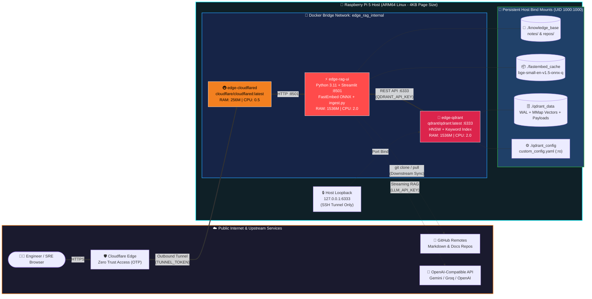

<div align="center">


[-C51A4A?style=for-the-badge&logo=raspberrypi&logoColor=white)](https://www.raspberrypi.com/)
[](https://www.python.org/)
[](https://streamlit.io/)
[-DC244C?style=for-the-badge&logo=rust&logoColor=white)](https://qdrant.tech/)
[-00B4D8?style=for-the-badge&logo=onnx&logoColor=white)](https://github.com/qdrant/fastembed)
[-8A2BE2?style=for-the-badge&logo=huggingface&logoColor=white)](https://huggingface.co/BAAI/bge-small-en-v1.5)
[-10A37F?style=for-the-badge&logo=openai&logoColor=white)](https://github.com/openai/openai-python)
[](#-%EF%B8%8F-automated-knowledge_base-feeder--downstream-git-sync)
[](https://docs.docker.com/compose/)
[](https://www.cloudflare.com/zero-trust/)
[-2EA043?style=for-the-badge&logo=linux&logoColor=white)](#%EF%B8%8F-security--zero-trust-posture)

<br />

**A low-latency, memory-disciplined Semantic Search & Retrieval-Augmented Generation (RAG) Knowledge Hub engineered specifically for constrained ARM64 edge hardware.**

[✨ Overview](#-executive-overview) •
[🏗️ Architecture](#%EF%B8%8F-system-architecture--data-flow) •
[📂 Repository Map](#-repository-structure) •
[🗄️ Auto-Feeder & Git Sync](#%EF%B8%8F-automated-knowledge_base-feeder--downstream-git-sync) •
[⚙️ Tech & Vector Specs](#%EF%B8%8F-vector-engine--embedding-specifications) •
[🖥️ UI Features](#%EF%B8%8F-application-capabilities--ui-tour) •
[🚀 Quick Start & CLI](#-deployment--operations) •
[🔍 Codebase Audit](#-technical-due-diligence--codebase-audit)

</div>

---

## ✨ Executive Overview

**Edge RAG Hub** is a self-contained, three-service microservice stack designed to automatically ingest, synchronize, manage, and semantically search technical runbooks, NOC/SRE incident playbooks, and GitHub repositories directly on a **Raspberry Pi 5 (ARM64)**—complete with grounded LLM answer synthesis and inline source citations.

> [!TIP]
> **Why ONNX + Rust on Edge?** Standard PyTorch + Transformer stacks easily consume `4 GB+` of RAM just to load runtime dependencies. By pairing **FastEmbed's quantized ONNX runtime** (`qdrant/bge-small-en-v1.5-onnx-q`) with **Qdrant's Rust engine** configured for `on_disk_payload` and memory-mapped segments, the entire stack operates comfortably inside a strict **3.25 GB RAM** and **4.5 CPU** ceiling.

### 🎯 Core Highlights

| Pillar | Implementation | Edge Benefit |
| :--- | :--- | :--- |
| 🧠 **Local CPU Vectorization** | `FastEmbed 0.4.2` + Quantized `BAAI/bge-small-en-v1.5` (`threads=4`) | Sub-50ms CPU query embeddings with zero external embedding API cost |
| 🦀 **Rust HNSW Vector Engine** | `qdrant/qdrant:latest` with `Cosine` distance & `KEYWORD` payload indexing | Millisecond filtered similarity search with minimal memory footprint |
| 🗄️ **Auto `knowledge_base` Feeder** | Startup & on-demand indexing of `/app/knowledge_base` (`notes/` & `repos/`) | Deterministic `UUIDv5` chunking that preserves UI category edits across re-syncs |
| 🔄 **Downstream Git Sync** | Built-in `git clone --depth 1` & `git pull --ff-only` pipeline (`ingest.py`) | Keep external documentation repos and notes synchronized downstream with one click or cron |
| 🤖 **Grounded LLM RAG Synthesis** | OpenAI-compatible streaming client (`openai>=1.52.0`) with strict citation rules | Generates answers grounded strictly in retrieved Qdrant vectors with `[1]`, `[2]` citations |
| 💾 **Flash/RAM Optimization** | `on_disk_payload: true` + `20 MB` `mmap` threshold + hard Docker cgroup caps | Prevents Linux OOM-killer events on 4 GB / 8 GB Raspberry Pi nodes |
| 🛡️ **Zero Public Port Exposure** | Outbound-only `cloudflared` tunnel + Cloudflare Zero Trust OTP Access | No port forwarding (`80`/`443`/`8501`) on the edge router; Qdrant bound to `127.0.0.1` |

---

## 🏗️ System Architecture & Data Flow

### 🌐 Container & Network Topology

All services communicate exclusively over an isolated Docker bridge network (`edge_rag_internal`). Public traffic enters through **Cloudflare Zero Trust**, while administrative Qdrant inspection is restricted to host loopback (`127.0.0.1:6333`).



### 🔄 Downstream Git Sync, Semantic Ingestion & RAG Sequence

```mermaid
sequenceDiagram
    autonumber
    actor User as 👩‍💻 User (Browser / CLI)
    participant GH as 🐙 GitHub Remote
    participant KB as 📂 /app/knowledge_base
    participant UI as ⚡ edge-rag-ui (ONNX + ingest.py)
    participant QD as 🦀 edge-qdrant (Rust HNSW)
    participant LLM as 🤖 LLM API (Streaming)

    rect rgb(20, 45, 76)
        Note over User,QD: 📥 Phase 1 — Automated knowledge_base Feeder & Downstream Git Sync
        User->>UI: Container Startup / Click "Sync knowledge_base & Git" / CLI --sync-all
        UI->>GH: git pull --ff-only across tracked repos in knowledge_base/repos/
        GH-->>KB: Update downstream Markdown files on disk
        UI->>KB: Scan notes/ & repos/ (.md, .mdx, .txt) & split by #, ##, ### headers
        UI->>UI: Compute deterministic UUIDv5(rel_source:title:idx) & infer category
        UI->>QD: Retrieve existing point IDs to preserve any UI Category Updates
        UI->>UI: Vectorize chunks in batches of 64 via ONNX (threads=4)
        UI->>QD: Upsert PointStructs (384-d vector + preserved category payload)
    end

    rect rgb(45, 25, 65)
        Note over User,LLM: 🔎 Phase 2 — Filtered Semantic Retrieval & Grounded RAG Synthesis
        User->>UI: Enter symptom query + Category Filter + Min Cosine Score
        UI->>UI: Embed query string -> 384-d vector (measure t_embed ms)
        UI->>QD: Search(query_vector, FieldCondition(category), limit=5, score_threshold)
        QD-->>UI: Return top-K ScoredPoints (measure t_search ms)
        opt AI Answer Toggle Enabled
            UI->>LLM: Stream numbered context blocks [1]..[5] + strict citation system prompt
            LLM-->>User: Stream grounded answer with inline [1], [2] citations & References
        end
        UI-->>User: Render source cards + telemetry banner + raw JSON payload inspector
    end
```



---

## 📂 Repository Structure

```text
edge-rag-hub/
├── 📄 docker-compose.yml                 # 3-service orchestration with hard cgroup resource caps
├── 🔐 .env                               # Environment secrets (TUNNEL_TOKEN, QDRANT_API_KEY, LLM_API_KEY, etc.)
├── 🙈 .gitignore                         # Tracks knowledge_base/notes/ while ignoring caches, DB storage & cloned repos
├── 📁 app/                               # Streamlit RAG UI, FastEmbed ONNX & Git Sync microservice
│   ├── 🐳 Dockerfile                     # Python 3.11-slim-bookworm image (curl + git) running as appuser (UID 1000)
│   ├── 🐍 main.py                        # Production Streamlit UI (RAG Search, Ingest/Git Sync, Category Management)
│   ├── 🔄 ingest.py                      # Automated knowledge_base feeder, header chunker & downstream Git sync CLI
│   ├── 🕰️ main.py.old                    # Historical snapshot preserved for reference
│   └── 📋 requirements.txt               # Pinned dependencies (streamlit, qdrant-client, fastembed, pandas, openai)
├── 📁 knowledge_base/                    # Mounted into edge-rag-ui:/app/knowledge_base (UID 1000:1000)
│   ├── 📁 notes/                         # Local & uploaded Markdown notes organized by category subfolder
│   │   └── .gitkeep                      # Tracked in parent Git repository
│   └── 📁 repos/                         # Downstream cloned GitHub repositories (git pull --ff-only)
│       └── .gitkeep                      # Directory structure tracked; cloned sub-repos excluded via .gitignore
├── 📁 qdrant_config/
│   └── ⚙️ custom_config.yaml             # Edge-tuned Qdrant storage, memmap, and service configuration
├── 📁 fastembed_cache/                   # Persisted HuggingFace/ONNX model cache mounted into /app/model_cache
│   └── 📦 models--qdrant--bge-small-en-v1.5-onnx-q/
└── 📁 qdrant_data/                       # Persisted Qdrant storage mounted into /qdrant/storage
    └── collections/knowledge_hub/        # Active 384-d Cosine vector collection + keyword payload index
```

---

## 🗄️ Automated `knowledge_base` Feeder & Downstream Git Sync

Implemented across [`app/ingest.py`](file:///z:/opt/edge-rag-hub/app/ingest.py) and [`app/main.py`](file:///z:/opt/edge-rag-hub/app/main.py), the knowledge base pipeline ensures `/opt/edge-rag-hub/knowledge_base` acts as a persistent, Git-synchronizable source of truth:

### 1. Startup Auto-Feeder & In-Process Execution
* On container startup, [`auto_feed_knowledge_base()`](file:///z:/opt/edge-rag-hub/app/main.py#L94-L109) runs automatically via `@st.cache_resource` (strictly after [`ensure_collection()`](file:///z:/opt/edge-rag-hub/app/main.py#L80-L91) and before [`get_active_categories()`](file:///z:/opt/edge-rag-hub/app/main.py#L112-L124)).
* When triggered from the Streamlit UI, [`sync_knowledge_base()`](file:///z:/opt/edge-rag-hub/app/ingest.py#L318-L343) executes **in-process**, reusing the already loaded ONNX `embedder` and `qdrant` client in memory rather than spawning a duplicate Python process—saving ~400 MB of RAM on the Raspberry Pi 5.

### 2. Header-Aware Markdown Chunking
* [`chunk_markdown()`](file:///z:/opt/edge-rag-hub/app/ingest.py#L50-L97) splits documents logically along `#`, `##`, and `###` Markdown headers while preserving the document title context (`{Document} — {Heading}`).
* Long sections exceeding `1,500` characters are automatically sub-chunked along paragraph boundaries (`(Part 1)`, `(Part 2)`) to fit cleanly within the `512`-token context window of `BAAI/bge-small-en-v1.5`.

### 3. 4-Tier Smart Category Resolution
When indexing a new file from `/app/knowledge_base`, [`infer_file_category()`](file:///z:/opt/edge-rag-hub/app/ingest.py#L181-L201) assigns its initial category using the following priority order:
1. **Explicit Category Override:** Passed via UI selector or `--category` CLI flag.
2. **YAML Frontmatter Extraction:** Parsed from `category: <Name>` in the Markdown frontmatter via [`extract_frontmatter_category()`](file:///z:/opt/edge-rag-hub/app/ingest.py#L36-L47).
3. **Subfolder Inference:** Inferred from the parent directory when placed under `knowledge_base/notes/<CategoryName>/file.md`.
4. **Default Fallback:** Falls back to `Documentation`.

### 4. Deterministic `UUIDv5` & Category Update Preservation
* Every chunk is assigned a deterministic point ID:
  ```python
  point_id = str(uuid.uuid5(uuid.NAMESPACE_DNS, f"{rel_source}:{c['title']}:{idx}"))
  ```
* **Category Preservation Guarantee:** Before upserting a batch, [`index_files_into_qdrant()`](file:///z:/opt/edge-rag-hub/app/ingest.py#L204-L315) queries Qdrant (`client.retrieve`) for existing point IDs. If a point already exists in Qdrant and has a `category` assigned (for example, reclassified via the **Vector Collection Explorer** UI), its existing category is **automatically preserved** unless `--force-category` (or the UI overwrite checkbox) is explicitly enabled.

### 5. Downstream Git Synchronization
* [`clone_or_pull_repo()`](file:///z:/opt/edge-rag-hub/app/ingest.py#L107-L120) clones new GitHub repositories (`git clone --depth 1`) into `/app/knowledge_base/repos/<repo_name>` or pulls downstream commits (`git -C <repo_path> pull --ff-only`).
* [`sync_downstream_git_repos()`](file:///z:/opt/edge-rag-hub/app/ingest.py#L123-L167) iterates across `/app/knowledge_base`, `/app/knowledge_base/notes`, and all cloned repositories under `/app/knowledge_base/repos/*` to pull upstream changes downstream into the edge node before re-indexing.
* Supports optional `GITHUB_PAT` injection for cloning and pulling private GitHub repositories.

---

## ⚙️ Vector Engine & Embedding Specifications

### 🧠 Quantized ONNX Embedding Model

Cached locally in `fastembed_cache/` and initialized in [`app/main.py`](file:///z:/opt/edge-rag-hub/app/main.py#L58-L60):

| Parameter | Value | Details |
| :--- | :--- | :--- |
| **Base Model** | `BAAI/bge-small-en-v1.5` | High-performing English semantic retrieval model |
| **ONNX Distribution** | `qdrant/bge-small-en-v1.5-onnx-q` | Quantized ONNX graph (`model_optimized.onnx`) |
| **Architecture** | `BertModel` (`gelu` activation) | 12 hidden layers, 12 attention heads, `1536` intermediate size |
| **Vector Dimensionality** | `384` | Compact representation ideal for edge memory limits |
| **Max Sequence Length** | `512` tokens | Vocab size: `30,522` tokens (`1,500`-char chunk ceiling) |
| **Inference Threads** | `4` CPU threads | Explicitly pinned via `TextEmbedding(..., threads=4)` for Pi 5 quad-core CPU |

### 🦀 Qdrant Collection & Storage Tuning

Configured via [`qdrant_config/custom_config.yaml`](file:///z:/opt/edge-rag-hub/qdrant_config/custom_config.yaml):

```yaml
storage:
  on_disk_payload: true          # Keeps document text & metadata on disk rather than RAM
  optimizers:
    indexing_threshold_kb: 10000 # Build HNSW index once segment exceeds 10 MB
    memmap_threshold_kb: 20000   # Memory-map vector segments exceeding 20 MB

service:
  enable_tls: false              # Terminated upstream at Cloudflare Zero Trust
  max_request_size_mb: 32        # Caps maximum batch ingestion payload size
```

---

## 🖥️ Application Capabilities & UI Tour

The Streamlit application ([`app/main.py`](file:///z:/opt/edge-rag-hub/app/main.py)) is organized into a **Live Telemetry Sidebar** and **Three Operational Tabs**:

### 1️⃣ Sidebar: Edge Node Telemetry & One-Click Sync
* Displays live **Vectors Stored**, **Dimensions (`384`)**, **KB Files** count on disk, **Git Repos** count, active **Embedder**, **LLM Engine**, and **Active Categories**.
* **🔄 Sync `knowledge_base` & Git:** Pulls downstream Git commits across all repositories in `/app/knowledge_base` and indexes new/modified files while preserving existing category assignments.
* **🚀 Load Sample NOC/SRE Playbooks:** Persists 5 curated operational playbooks into `/app/knowledge_base/notes/<Category>/` and indexes them into Qdrant using deterministic `UUIDv5` IDs.

### 2️⃣ Tab 1: `🔎 Semantic Retrieval & RAG`
* **Natural Language Querying:** Search by incident symptoms or architectural questions.
* **Pre-Filtered HNSW Search:** Filter by `All` or any dynamically discovered category (`DEFAULT_CATEGORIES` merged with live Qdrant categories).
* **🤖 Grounded AI Answer Synthesis:** Uses [`build_rag_messages()`](file:///z:/opt/edge-rag-hub/app/main.py#L263-L300) to format top retrieved chunks into numbered blocks (`[1]`, `[2]`) and streams an LLM response with strict inline citations, a `### References` section, and a **🔬 Inspect Augmented RAG Prompt** expander.
* **Split-Timer Telemetry & Payload Inspector:** Displays separate execution timers (`ms`) for **ONNX CPU Embedding** vs. **Qdrant Rust Lookup**, plus raw JSON payload inspection per hit.

### 3️⃣ Tab 2: `📥 Ingest & Git Sync`
* **Manual Playbook Entry Form:** Vectorizes notes directly into Qdrant and optionally saves them as Markdown files with YAML frontmatter inside `/app/knowledge_base/notes/<Category>/`.
* **📂 Batch Markdown File Uploader (`.md`, `.mdx`, `.txt`):** Saves uploaded files to `/app/knowledge_base/notes/<Category>/`, splits them by headers via [`chunk_markdown()`](file:///z:/opt/edge-rag-hub/app/ingest.py#L50-L97), and indexes them into Qdrant.
* **🐙 Downstream Git Sync & Repo Ingestion:** Clones or pulls any GitHub repository into `/app/knowledge_base/repos/` and vectorizes its documentation.
* **🗄️ Automatic `knowledge_base` Folder & Downstream Git Status:** Displays live inventory of local notes and cloned repositories with a one-click **Pull All Downstream Git Repos & Re-Index KB** action.

### 4️⃣ Tab 3: `📊 Vector Collection Explorer`
* **Collection Dataframe:** Scrolls up to 250 vectors from Qdrant and renders a sortable table of `id`, `title`, `category`, `source`, and `indexed_at`.
* **✏️ Update Individual Document Category:** Uses `qdrant.set_payload()` targeting a specific point UUID to reclassify individual documents without re-embedding.
* **🏷️ Bulk Update Category:** Uses `qdrant.set_payload()` with a `Filter(must=[FieldCondition(...)])` to atomically migrate all points under an existing category to a new category name.

---

## 🐳 Resource Budget & Container Matrix

Defined in [`docker-compose.yml`](file:///z:/opt/edge-rag-hub/docker-compose.yml), every container enforces strict Docker `deploy.resources.limits` to guarantee stability on a Raspberry Pi 5:

| Container Name | Service | Base Image | Internal Port | Host Port Binding | CPU Limit | Memory Limit |
| :--- | :--- | :--- | :---: | :---: | :---: | :---: |
| `edge-qdrant` | `qdrant` | `qdrant/qdrant:latest` | `6333/tcp` | `127.0.0.1:6333` | `2.0` CPUs | `1536 MB` |
| `edge-rag-ui` | `rag-ui` | Custom (`python:3.11-slim-bookworm`) | `8501/tcp` | *None (Internal)* | `2.0` CPUs | `1536 MB` |
| `edge-cloudflared` | `cloudflared` | `cloudflare/cloudflared:latest` | *N/A* | *None (Outbound)* | `0.5` CPUs | `256 MB` |
| **Total Stack Allocation** | | | | | **4.5 CPUs** | **3,328 MB (~3.25 GB)** |

---

## 🚀 Deployment & Operations

### 1. Environment Configuration (`.env`)

Create or update `.env` in `/opt/edge-rag-hub/.env`:

```dotenv
# Cloudflare Zero Trust Tunnel Token
TUNNEL_TOKEN=<your_cloudflare_tunnel_token>

# Shared secret API key between edge-rag-ui and edge-qdrant
QDRANT_API_KEY=<your_64_char_hex_api_key>
QDRANT_COLLECTION=knowledge_hub

# Default categories merged with live Qdrant categories
DEFAULT_CATEGORIES=Network,Cloud,Infrastructure,Database,Security,Python,Documentation

# OpenAI-Compatible LLM Configuration for RAG Synthesis
LLM_API_KEY=<your_llm_api_key>
LLM_BASE_URL=https://generativelanguage.googleapis.com/v1beta/openai/
LLM_MODEL=gemini-3.8-flash

# Optional: Personal Access Token for private GitHub repository cloning/pulling
GITHUB_PAT=
```

### 2. Build & Launch the Stack

```bash
# Ensure non-root container user (UID 1000) owns bind-mounted directories
sudo chown -R 1000:1000 /opt/edge-rag-hub/knowledge_base /opt/edge-rag-hub/fastembed_cache /opt/edge-rag-hub/qdrant_data

# Build and start all services in detached mode
cd /opt/edge-rag-hub && docker compose up -d --build
```

### 3. CLI Ingestion & Downstream Git Synchronization Commands

You can trigger [`ingest.py`](file:///z:/opt/edge-rag-hub/app/ingest.py) directly via `docker exec` or schedule it with `cron` / `systemd`:

```bash
# Pull latest changes across all cloned Git repos in knowledge_base and index all files (preserves UI category edits)
docker exec -it edge-rag-ui python ingest.py --sync-all

# Clone or pull a specific GitHub repository into knowledge_base/repos/ and index under a category
docker exec -it edge-rag-ui python ingest.py --github https://github.com/owner/repo --category "Cloud"

# Index a specific directory inside the container
docker exec -it edge-rag-ui python ingest.py --dir /app/knowledge_base/notes --category "Infrastructure"

# Force-overwrite existing Qdrant categories during CLI re-indexing
docker exec -it edge-rag-ui python ingest.py --sync-all --force-category
```

### 4. Optional Nightly Cron Sync on Host

To automatically pull downstream Git repositories and re-index `/opt/edge-rag-hub/knowledge_base` every night at `02:00 UTC`:

```bash
(crontab -l 2>/dev/null; echo "0 2 * * * docker exec edge-rag-ui python ingest.py --sync-all >> /var/log/edge-rag-sync.log 2>&1") | crontab -
```

---

## 🔍 Technical Due Diligence & Codebase Audit

All previously identified architectural items have been resolved and verified in the current production state:

> [!IMPORTANT]
> **1. Raspberry Pi 5 Kernel Page Size (`4KB` Required)**
> Raspberry Pi OS defaults to a `16KB` page size (`kernel_2712.img`), which causes Qdrant's `jemalloc` allocator to abort on startup. The host is configured with `kernel=kernel8.img` in `/boot/firmware/config.txt` (`getconf PAGE_SIZE` = `4096`).

> [!NOTE]
> **2. Resolved `ingest.py` Packaging & Volume Mounts**
> * [`app/Dockerfile`](file:///z:/opt/edge-rag-hub/app/Dockerfile) installs both `curl` and `git`, provisions `/app/model_cache` and `/app/knowledge_base` under `appuser` (`UID 1000`), and copies the entire application context (`COPY --chown=appuser:appuser . .`).
> * [`docker-compose.yml`](file:///z:/opt/edge-rag-hub/docker-compose.yml) bind-mounts `./knowledge_base:/app/knowledge_base` into `edge-rag-ui`.

> [!TIP]
> **3. Strict Initialization Order & Idempotent Category Preservation**
> * [`app/main.py`](file:///z:/opt/edge-rag-hub/app/main.py#L146-L152) enforces a strict startup sequence: `load_embedder()` → `get_qdrant_client()` → `get_llm_client()` → `ensure_collection(qdrant)` → `auto_feed_knowledge_base(qdrant, embedder)` → `get_active_categories(qdrant)`.
> * Re-indexing files from `/app/knowledge_base` or downstream Git repositories uses deterministic `UUIDv5` IDs and checks existing payloads in Qdrant first, guaranteeing that manual or bulk category changes made in the UI are never overwritten unintentionally.
> * [`.gitignore`](file:///z:/opt/edge-rag-hub/.gitignore) excludes `.env`, `qdrant_data/`, `fastembed_cache/`, and cloned external sub-repositories (`knowledge_base/repos/*`) while keeping `knowledge_base/notes/` tracked in Git.

---

<div align="center">


**Built for Edge AI & SRE Resilience • Powered by Qdrant, FastEmbed ONNX, Streamlit & Cloudflare Zero Trust**

</div>
