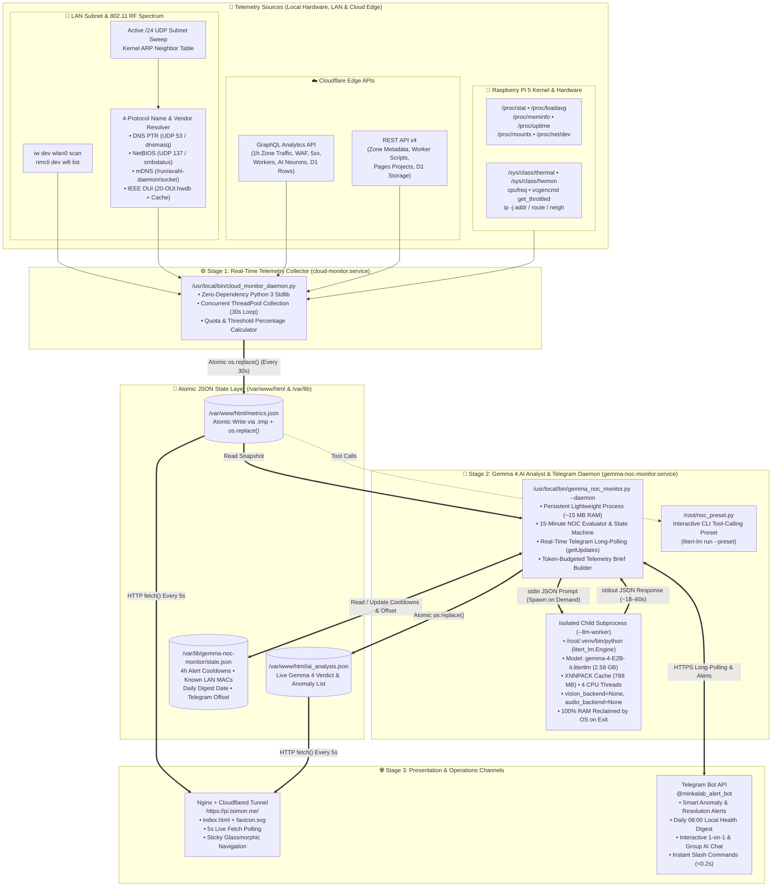
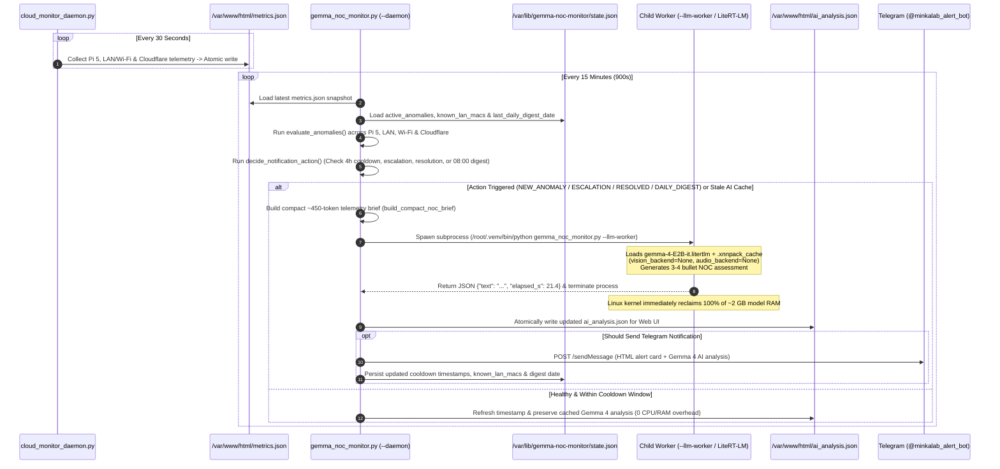
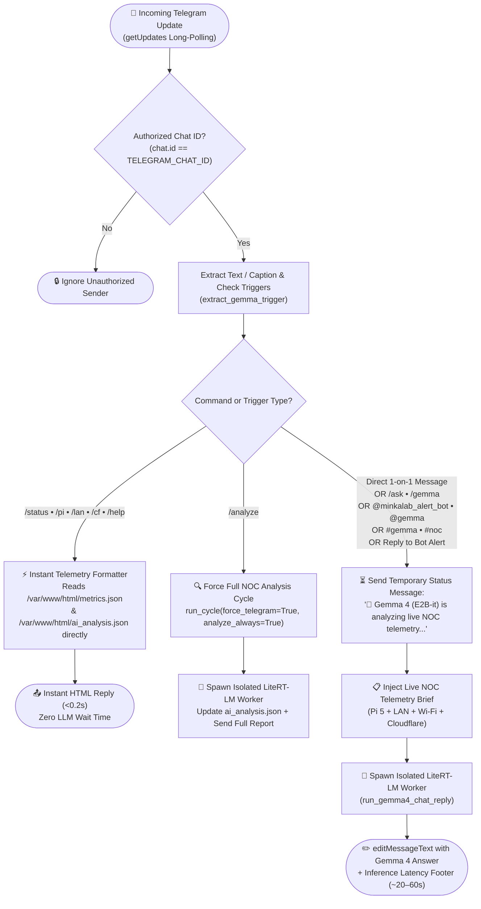

<div align="center">


# 🍓 Edge & Local Network Operations Center (Raspberry Pi NOC)

**Zero-Dependency Real-Time Cloud Edge, Local Linux Hardware & LAN/Wi-Fi Spectrum Observability Platform Powered by On-Device Google Gemma 4 (LiteRT-LM) & Interactive Telegram Ops Bot**

[-C51A4A?style=for-the-badge&logo=raspberrypi&logoColor=white)](https://www.raspberrypi.com/products/raspberry-pi-5/)
[-A81D33?style=for-the-badge&logo=debian&logoColor=white)](https://www.debian.org/)
[-4285F4?style=for-the-badge&logo=google&logoColor=white)](https://ai.google.dev/edge/litert)
[-8E75B2?style=for-the-badge&logo=googlegemini&logoColor=white)](https://huggingface.co/litert-community/gemma-4-E2B-it-litert-lm)
[](https://t.me/minkalab_alert_bot)
[](https://developers.cloudflare.com/analytics/graphql-api/)
[](https://www.python.org/)
[](https://pi.tsimon.me/)

[](#-6-full-application-deployment--systemd-configuration)
[](#-32-lan-device-discovery-wi-fi-spectrum--4-protocol-name-resolution)
[-818CF8?style=flat-square)](#-32-lan-device-discovery-wi-fi-spectrum--4-protocol-name-resolution)
[-10B981?style=flat-square)](#-34-gemma_noc_monitorpy--autonomous-gemma-4-ai-analyst--telegram-bot)
[](#)

<br />

[**🌐 Live NOC Dashboard (`pi.tsimon.me`)**](https://pi.tsimon.me/) •
[**✨ Overview**](#-1-executive-overview) •
[**🏗️ Architecture & Mermaid Diagrams**](#%EF%B8%8F-2-system-architecture--mermaid-diagrams) •
[**⚙️ How It Works**](#%EF%B8%8F-3-how-the-application-works-core-components) •
[**💬 Telegram Bot & Chat Guide**](#-4-interactive-telegram-bot--chat-guide-minkalab_alert_bot) •
[**🧠 Install LiteRT & Gemma 4**](#-5-installing-google-litert-lm--gemma-4-on-raspberry-pi-5) •
[**🚀 Deployment & Systemd**](#-6-full-application-deployment--systemd-configuration) •
[**🛠️ CLI & Troubleshooting**](#%EF%B8%8F-7-cli-operations-verification--troubleshooting)

</div>

---

## ✨ 1. Executive Overview

**Raspberry Pi NOC** is a self-contained, 24/7 **Edge & Local Network Operations Center (NOC)** observability platform, **autonomous on-device Gemma 4 AI engineer**, **two-way interactive Telegram operations bot (`@minkalab_alert_bot`)**, and **real-time glassmorphic web dashboard** running natively on a **Raspberry Pi 5 (`aarch64`, Debian 13.7 Trixie)** and served globally via Cloudflare Tunnel + Nginx at **[`https://pi.tsimon.me/`](https://pi.tsimon.me/)** (`/var/www/html/`).

### 🎯 Four Core Operational Pillars

| Pillar | Component | Cadence | Key Capabilities |
| :--- | :--- | :---: | :--- |
| **1. Local Linux & Hardware Telemetry** | `cloud_monitor_daemon.py` | Every **30s** | Aggregate & per-core ARM Cortex-A76 CPU load, clock speeds, BCM2712 SoC & RP1 Southbridge thermals, PWM fan RPM, hardware under-voltage/thermal throttling bitmasks, RAM/Swap, block filesystems, and live per-NIC throughput (`RX/TX kbps`). |
| **2. LAN Discovery, Wi-Fi RF & Name Resolution** | `cloud_monitor_daemon.py` | Every **30s** | Hardware 802.11 Wi-Fi spectrum scanning (`iw`/`nmcli`), active `/24` UDP ARP subnet sweeps, 4-tier IEEE OUI vendor identification (35,000+ prefixes + privacy MAC & range-extender detection), and concurrent 4-protocol hostname resolution (**DNS PTR**, **NetBIOS/Samba**, **mDNS/Avahi**, and **HTTP appliance titles**). |
| **3. Cloudflare Multi-Zone & Serverless Quotas** | `cloud_monitor_daemon.py` | Every **30s** | Per-domain edge routing status (`tsimon.me`, `minkalab.net`, `tsimon.app`), 1h HTTP requests, bandwidth, cache hit ratio, WAF threat blocks, `5xx` origin errors, and account-wide free-tier/billing quotas for **Workers & Pages**, **Workers AI (Neurons & Tokens)**, and **D1 SQL Databases**. |
| **4. Autonomous Gemma 4 AI Analyst & Telegram Bot** | `gemma_noc_monitor.py` + `noc_preset.py` | Every **15m** + **Real-Time Chat** | Runs Google's compiled **`gemma-4-E2B-it.litertlm`** model on-device via **LiteRT-LM (XNNPACK)** inside an isolated child worker (`0 MB` idle LLM RAM), writes live AI verdicts to `/var/www/html/ai_analysis.json`, sends smart Telegram alerts with a 4-hour per-anomaly cooldown + 08:00 daily digest, and provides 24/7 two-way Telegram chat & slash commands. |

---

## 🏗️ 2. System Architecture & Mermaid Diagrams

### 2.1 End-to-End System Topology & Data Flow



---

### 2.2 Autonomous 15-Minute NOC Evaluation, Smart Alerting & Subprocess RAM Reclamation



---

### 2.3 Interactive Two-Way Telegram Bot Routing Flow



---

## ⚙️ 3. How the Application Works (Core Components)

### 3.1 [`cloud_monitor_daemon.py`](cloud_monitor_daemon.py) — Zero-Dependency Telemetry & Discovery Engine

Located at `/usr/local/bin/cloud_monitor_daemon.py` and managed by `cloud-monitor.service`, this daemon uses **100% Python 3 Standard Library** modules (`urllib.request`, `json`, `socket`, `subprocess`, `concurrent.futures`, `os`, `stat`, `time`) so it never suffers from broken third-party C-extensions or virtual environment drift. Every 30 seconds, it executes three concurrent collection pipelines and atomically flushes the unified state to `/var/www/html/metrics.json` (via `/var/www/html/metrics.json.tmp` + `os.replace()`).

#### Local Raspberry Pi 5 Linux & Hardware Collector (`collect_local_system_metrics`)
| Subsystem | Metrics Collected | Kernel / Hardware Source |
| :--- | :--- | :--- |
| **Host & OS Identity** | Hostname (`rpi`), OS release (`Debian GNU/Linux 13 (trixie)`), kernel version, SBC model (`Raspberry Pi 5 Model B Rev 1.0`), uptime, process counts | `/etc/os-release`, `/proc/device-tree/model`, `/proc/uptime`, `/proc/loadavg` |
| **System Load** | `1m`, `5m`, and `15m` load averages, logical CPU core count (`4`), normalized load percentage (`load_pct`) | `os.getloadavg()`, `/proc/loadavg` |
| **CPU & Clocks** | Aggregate CPU `%`, per-core utilization (`C0`–`C3`), current/max clock frequency (`MHz`), scaling governor, ARM Cortex-A76 part ID | `/proc/stat` (jiffies delta), `/sys/devices/system/cpu/cpu0/cpufreq/*`, `/proc/cpuinfo` |
| **Thermals, Fan & Power** | BCM2712 SoC temperature (`°C`), RP1 Southbridge temperature (`°C`), PWM cooling fan speed (`RPM`), hardware under-voltage & thermal throttling bitmask (`0x0`) | `/sys/class/thermal/thermal_zone*`, `/sys/class/hwmon/hwmon*`, `vcgencmd get_throttled` |
| **RAM & Swap Memory** | Total, Used, Available, Free, and Buffers/Cached RAM (`MB` & `%`); Swap Total, Used, and Free (`MB` & `%`) | `/proc/meminfo` |
| **Block Filesystems** | Mountpoint (`/`, `/boot/firmware`), device (`/dev/mmcblk0p2`), filesystem type (`ext4`, `vfat`), Total/Used/Free `GB`, capacity `%` | `/proc/mounts` + `os.statvfs()` |
| **Network Interfaces** | Interface classification (`Ethernet`, `Wi-Fi`, `Docker/Bridge`, `VPN/Tunnel`), `UP`/`DOWN` state, IPv4/IPv6 CIDRs, default gateways, MAC & OUI vendor, link speed (`Mbps`), MTU, real-time `RX/TX` throughput (`kbps`), cumulative bytes/packets/errors/drops, associated Wi-Fi SSID & RSSI | `/proc/net/dev` (delta rate calculation), `/sys/class/net/*`, `ip -j addr`, `ip -j route`, `iw dev wlan0 link` |

---

### 3.2 LAN Device Discovery, Wi-Fi Spectrum & 4-Protocol Name Resolution

Implemented inside [`cloud_monitor_daemon.py`](cloud_monitor_daemon.py), the `lan_network` collector builds a complete Layer-2/Layer-3 inventory of the local `192.168.1.0/24` network and surrounding RF environment:

1. **802.11 Wi-Fi RF Spectrum Scanner (`scan_wifi_networks`)**:
   - Performs hardware wireless scans via `iw dev wlan0 scan` (with `nmcli dev wifi list` supplement/fallback).
   - Extracts **SSID** (including `\xHH` UTF-8 hex escape decoding), **BSSID**, **AP Hardware Vendor (OUI)**, **Band** (`2.4 GHz`, `5 GHz`, `6 GHz`), **Channel & Frequency (`MHz`)**, **802.11 Standard** (`Wi-Fi 4 802.11n`, `Wi-Fi 5 802.11ac`, `Wi-Fi 6 802.11ax`, `Wi-Fi 7 802.11be`), **Signal Strength** (`dBm` and quality `%`), **Security Suites** (`WPA2-CCMP`, `WPA3-SAE`), and active association status.
2. **Active `/24` Subnet Sweep & Kernel Neighbor Inspection**:
   - Sends fast, non-blocking UDP probes across `192.168.1.1`–`192.168.1.254` to populate the Linux kernel ARP cache for all online hosts, then merges `/proc/net/arp` and `ip -j neigh show` across physical interfaces (`eth0`, `wlan0`) and measures round-trip latency (`rtt_ms`).
3. **4-Tier Hardware MAC Vendor Resolution (IEEE OUI)**:
   - **Tier 1**: Local Linux udev hardware database (`/usr/lib/udev/hwdb.d/20-OUI.hwdb`, 35,000+ IEEE OUI prefixes) and `/usr/share/ieee-data/oui.txt`.
   - **Tier 2**: Curated built-in OUI dictionary + persistent local disk cache (`/var/tmp/noc_oui_cache.json`).
   - **Tier 3**: Online OUI lookup fallback for newly registered IEEE blocks.
   - **Tier 4**: Automatic **Locally Administered / Randomized Privacy MAC** bit (`0x02` in first octet) detection and **Wi-Fi Range Extender BSSID cross-referencing** (matching lower 5 MAC octets to identify virtual AP/extender interfaces).
4. **Concurrent 4-Protocol Hostname Resolution**:
   - **DNS PTR (`dns_name`)**: Checks local DHCP leases (`dnsmasq.leases`), `/etc/hosts`, system `socket.gethostbyaddr()`, and direct UDP port `53` reverse PTR queries to local DNS resolvers.
   - **NetBIOS / Samba (`netbios_name` & `netbios_group`)**: Inspects active Samba sessions (`smbstatus -b`), `/proc/<pid>/fd` log symlinks, and `/var/log/samba/log.*` files (guarded by a strict `2.0s` monotonic deadline and `st_size > 0` check so empty or locked logs never block), plus direct RFC 1002 UDP port `137` `NBSTAT` Node Status queries and `nmblookup -A`.
   - **mDNS / Avahi (`mdns_name`)**: Queries `/run/avahi-daemon/socket` (`RESOLVE-ADDRESS`) with thread lock serialization (`_AVAHI_LOCK`) and direct UDP port `5353` PTR queries for `.local` Apple/Linux/IoT devices.
   - **HTTP Appliance Fingerprinting**: Extracts `<title>` metadata from web-managed gateways/ONTs (e.g., ZTE `F6600P` fiber gateway) when DNS/NetBIOS/mDNS are disabled on the appliance.

---

### 3.3 Cloudflare Multi-Zone Edge & Serverless Billing Collector

Queries both the **Cloudflare GraphQL Analytics API** (`https://api.cloudflare.com/client/v4/graphql`) and **Cloudflare REST API v4** across configured zones (`tsimon.me`, `minkalab.net`, `tsimon.app`) and the account billing profile:

| Telemetry Domain | Metrics & Free-Tier Quota Thresholds |
| :--- | :--- |
| **Edge Domains (`domains`)** | Routing status (`HEALTHY`), 1-hour rolling HTTP requests, edge bandwidth (`GB`), cache hit ratio (`%`), WAF security threats blocked, and `5xx` origin gateway errors. |
| **Workers & Pages (`workers_and_pages`)** | Daily UTC requests vs. **`100,000 req/day`** free limit, MTD Worker & Pages Function invocations, subrequests, CPU time (`ms`), errors, static asset requests by hostname, and monthly Workers Build minutes vs. **`3,000 min/mo`** quota. |
| **Workers AI (`workers_ai`)** | Daily Neurons vs. **`10,000 Neurons/day`** free tier, MTD total & billable Neurons, estimated USD overage (`$0.011 / 1k Neurons`), input/output token counts, inference duration, and per-model breakdown. |
| **D1 Serverless SQL (`d1_billing` & `d1_databases`)** | Daily rows read vs. **`5,000,000 rows/day`** limit, daily rows written vs. **`100,000 rows/day`** limit, MTD queries, total account storage vs. **`5 GB`** limit, and per-database storage vs. **`500 MB`** limit. |

---

### 3.4 [`gemma_noc_monitor.py`](gemma_noc_monitor.py) — Autonomous Gemma 4 AI Analyst & Telegram Bot

Located at `/usr/local/bin/gemma_noc_monitor.py` (with a synchronized copy at `/root/gemma_noc_monitor.py`) and managed by `gemma-noc-monitor.service`, this service bridges the NOC telemetry pipeline with **Google LiteRT-LM (`gemma-4-E2B-it.litertlm`)** and **Telegram (`@minkalab_alert_bot`)**.

#### Memory-Disciplined Architecture (Why `--llm-worker` Subprocess Isolation?)
On a 4 GB Raspberry Pi 5 running Nginx, Docker (`edge-rag-hub` with Qdrant + ONNX), Samba, and system services, keeping a 2.58 GB LLM permanently resident in RAM would risk Linux OOM-killer pressure. `gemma_noc_monitor.py` solves this with a two-tier process model:
1. **Persistent Parent Daemon (`--daemon`, ~15 MB RAM)**: Runs 24/7 handling real-time Telegram `getUpdates` long-polling and the 15-minute deterministic NOC evaluation loop with near-zero memory footprint.
2. **Ephemeral Child Worker (`--llm-worker`, ~2.0 GB RAM during inference only)**: Whenever an AI NOC analysis or interactive Telegram chat reply is needed, the parent spawns `/root/.venv/bin/python /usr/local/bin/gemma_noc_monitor.py --llm-worker`, pipes the system instruction and telemetry prompt over `stdin`, and reads the generated response from `stdout`:
   ```python
   with litert_lm.Engine(
       model_path,
       backend=litert_lm.Backend.CPU,
       vision_backend=None,        # Skips 217 MB vision encoder + adapter
       audio_backend=None,         # Skips 100 MB audio encoder + adapter
       cache_dir=cache_dir,        # Reuses pre-compiled 788 MB .xnnpack_cache
       thread_count=4,             # Pinned to Pi 5 quad-core Cortex-A76
   ) as engine:
   ```
   - Disabling `vision_backend` and `audio_backend` saves **~310 MB of RAM** and cuts model load time significantly.
   - Pointing `cache_dir` to `/root/.litert-lm/cache/huggingface/litert-community/gemma-4-E2B-it-litert-lm` loads the pre-built 788 MB `.xnnpack_cache` in seconds instead of recompiling XNNPACK weights.
   - As soon as the child process exits (~18–60 seconds later), the Linux kernel immediately reclaims **100% of the ~2 GB model memory** (`0 MB` idle LLM RAM).

#### Deterministic Anomaly Detection Matrix (`evaluate_anomalies`)
Before invoking Gemma 4, [`evaluate_anomalies()`](gemma_noc_monitor.py#L221-L526) evaluates 16 deterministic rules across all telemetry domains:

| Category | Metric | Warning (`WARNING`) | Critical (`CRITICAL`) |
| :--- | :--- | :---: | :---: |
| **Telemetry Freshness** | `metrics.json` age | — | `> 600s` (10 min stale) |
| **Pi 5 CPU & Load** | CPU usage / Normalized `1m` Load | `>= 75%` | `>= 90%` |
| **Pi 5 Thermals** | BCM2712 SoC / RP1 Southbridge Temp | `>= 70.0 °C` | `>= 80.0 °C` |
| **Pi 5 Power / Throttle** | `vcgencmd get_throttled` bitmask | Historical throttle (`!= 0x0`) | Active under-voltage or thermal throttle |
| **Pi 5 Memory** | RAM usage / Swap usage | RAM `>= 85%` / Swap `>= 60%` | RAM `>= 92%` / Swap `>= 85%` |
| **Pi 5 Storage** | Block filesystem capacity (`/`, `/boot/firmware`) | `>= 80%` | `>= 90%` |
| **Pi 5 Network** | Primary NIC (`eth0`, `wlan0`) state | Interface `DOWN` | — |
| **LAN & Wi-Fi** | Default Gateway (`192.168.1.1`) / Wi-Fi RSSI / New MAC | Wi-Fi `<= -78 dBm` / Unrecognized LAN MAC | Gateway unreachable / Wi-Fi `<= -85 dBm` / 0 LAN hosts |
| **Cloudflare Domains** | Zone routing status / `5xx` errors / WAF threats | `5xx >= 1` or Threats `>= 25` (1h) | Zone `!= HEALTHY` or `5xx >= 10` or Threats `>= 100` |
| **Cloudflare Quotas** | Workers, Builds, Workers AI Neurons, D1 Rows & Storage | Quota `>= 75%` of free tier | Quota `>= 90%` of free tier |

#### Smart Notification State Machine (`decide_notification_action`)
Stored in `/var/lib/gemma-noc-monitor/state.json`, the alerting state machine prevents notification fatigue:
- **`NEW_CRITICAL_OR_ESCALATION`**: Fires immediately when a new `CRITICAL` anomaly appears or an existing `WARNING` escalates to `CRITICAL`.
- **`NEW_ANOMALY`**: Fires when a new anomaly key is detected, or re-notifies if an existing anomaly remains active after the **4-hour (`14400s`) cooldown**.
- **`RESOLVED`**: Fires an automatic **All-Clear Resolution** message on Telegram as soon as previously active anomalies return to normal.
- **`DAILY_DIGEST`**: Fires a scheduled daily health summary at **08:00 local time** (`America/La_Paz`, `UTC-4`) even when 0 anomalies occurred over the past 24 hours.

---

### 3.5 [`noc_preset.py`](noc_preset.py) — Interactive CLI Tool-Calling Preset

Located at `/root/noc_preset.py` (and in the repository root), this file defines four Python tool-calling functions for interactive terminal sessions using the `litert-lm` CLI:
- `get_local_system_status()` — Reads live Raspberry Pi 5 CPU, temperatures, fan, load, RAM, swap, disk, and NIC metrics from `/var/www/html/metrics.json`.
- `get_lan_and_wifi_status()` — Reads the active LAN device inventory and Wi-Fi spectrum scan results.
- `get_cloudflare_domains_and_quotas()` — Reads Cloudflare domain metrics (`tsimon.me`, `minkalab.net`, `tsimon.app`) and Workers/AI/D1 quotas.
- `send_telegram_alert(message: str)` — Dispatches an immediate alert message to the NOC Telegram chat.

---

### 3.6 [`index.html`](index.html) & [`favicon.svg`](favicon.svg) — Live Mission Control Web UI

Served directly at **`https://pi.tsimon.me/`** (`/var/www/html/index.html`):
- **Sticky Glassmorphic Section Navigation**: Floating translucent pill navbar (`backdrop-filter: blur(10px)`) with smooth anchor scrolling and `IntersectionObserver` scroll-spy highlighting across all 7 operational sections:
  1. `🧠 Gemma 4 LiteRT-LM Autonomous NOC Analyst` (live status badge, model latency, anomaly pills, and rendered AI assessment from `ai_analysis.json`)
  2. `🍓 Raspberry Pi 5 System & Storage`
  3. `🔌 Local Network Interfaces (RX/TX Throughput)`
  4. `📶 Wi-Fi RF Spectrum Scanner (2.4 GHz / 5 GHz)`
  5. `🖧 Active LAN Devices & 4-Protocol Name Resolution`
  6. `🌐 Cloudflare Multi-Zone Edge Operations`
  7. `⚡ Workers, Pages, Workers AI & D1 Serverless Quotas`
- **5-Second Cache-Busted Polling**: Fetches `/metrics.json?t=<timestamp>` and `/ai_analysis.json?t=<timestamp>` every 5 seconds with zero external JS/CSS dependencies.

---

## 💬 4. Interactive Telegram Bot & Chat Guide (`@minkalab_alert_bot`)

Because `gemma-noc-monitor.service` runs continuously with `--daemon`, you can chat two-way with Gemma 4 or query instant NOC telemetry from Telegram (`@minkalab_alert_bot`) at any time. Security is enforced by verifying that `chat.id` matches the authorized `TELEGRAM_CHAT_ID` (`8590242462`).

### 4.1 Three Ways to Trigger Gemma 4 AI Chat

1. **Direct 1-on-1 Chat (Plain Text — No Prefix Needed)**
   In your direct message thread with **`Minka Lab Alerts` (`@minkalab_alert_bot`)**, type any natural language question:
   - *"How is the Pi temperature and fan speed right now?"*
   - *"Are any of my Cloudflare domains seeing 5xx errors or attacks?"*
   - *"Which devices are currently online on the LAN?"*
2. **Mentions, Hashtags & Replies (For Channels or Group Chats)**
   - **Mentions**: Include `@minkalab_alert_bot`, `@gemma`, or `@gemma4` anywhere in the message (e.g., `@gemma why did swap usage increase?`).
   - **Hashtags**: Include `#gemma`, `#gemma4`, or `#noc` anywhere in the message (e.g., `Check if minkalab.net traffic is normal #gemma`).
   - **Reply to an Alert**: Simply **Reply** to any alert card sent by `@minkalab_alert_bot` to ask a follow-up question.
3. **Explicit AI Slash Commands**
   - `/ask <question>` or `/gemma <question>` — Ask Gemma 4 a question with the live NOC telemetry snapshot injected into its prompt.
   - `/analyze` — Force a fresh full Gemma 4 NOC evaluation immediately, dispatch the full report to Telegram, and update `/var/www/html/ai_analysis.json`.

### 4.2 Complete Telegram Slash Command Reference

All commands are automatically registered in Telegram's `/` command menu on daemon startup via `setMyCommands`:

| Command | Response Time | Description |
| :--- | :---: | :--- |
| `/status` | **Instant (`<0.2s`)** | Full NOC status overview (Pi 5, LAN, Cloudflare) + latest cached Gemma 4 AI assessment. |
| `/pi` | **Instant (`<0.2s`)** | Live Raspberry Pi 5 CPU %, load, SoC/RP1 temperatures, fan RPM, throttling, RAM, swap, disk & NICs. |
| `/lan` | **Instant (`<0.2s`)** | Active LAN devices (`192.168.1.0/24` with IP, hostname, vendor, RTT) & Wi-Fi 2.4/5 GHz spectrum summary. |
| `/cf` | **Instant (`<0.2s`)** | Cloudflare Edge domains (`tsimon.me`, `minkalab.net`, `tsimon.app`) 1h traffic/5xx/threats + Workers/AI/D1 quotas. |
| `/ask <question>` | **~20–60s (AI)** | Ask Gemma 4 (E2B-it) any custom question grounded in live NOC telemetry. |
| `/gemma <question>` | **~20–60s (AI)** | Alias for `/ask <question>`. |
| `/analyze` | **~20–60s (AI)** | Force an immediate Gemma 4 full NOC health analysis, Telegram report, and `ai_analysis.json` refresh. |
| `/help` | **Instant (`<0.2s`)** | Display all available chat triggers, mentions, hashtags, and slash commands. |

---

## 🧠 5. Installing Google LiteRT-LM & Gemma 4 on Raspberry Pi 5

Follow these exact steps to install **Google LiteRT-LM** and the **Gemma 4** model on a Raspberry Pi 5 running **Debian 13 (Trixie) `aarch64`**.

### 5.1 Step 1 — Create the Python 3.13 Virtual Environment (`/root/.venv`)

Using `uv` (or standard `python3 -m venv`), create a dedicated virtual environment at `/root/.venv`:

```bash
# 1. Install uv if not already present (or use python3.13 -m venv /root/.venv)
curl -LsSf https://astral.sh/uv/install.sh | sh
source ~/.bashrc

# 2. Create a clean Python 3.13 virtual environment with pip seed packages
cd /root
uv venv --clear --python=3.13 --seed /root/.venv
source /root/.venv/bin/activate
```

### 5.2 Step 2 — Install Google LiteRT-LM CLI & Python Runtime API

Install the LiteRT-LM CLI (`litert-cli-nightly`), the Python bindings (`litert-lm-api`), and the nightly LiteRT runtime (`ai-edge-litert-nightly`):

```bash
source /root/.venv/bin/activate

# Install LiteRT CLI, LiteRT-LM Python API, and runtime packages
uv pip install litert-cli-nightly litert-lm-api google-antigravity

# Verify installed versions
/root/.venv/bin/pip list | grep -E "litert|antigravity"
# Expected packages:
# ai-edge-litert-nightly    2.4.0.dev...
# google-antigravity        0.1.23
# litert-cli-nightly        0.3.0.dev...
# litert-lm-api             0.19.1
# litert-lm-api-nightly     0.20.0.dev...
# litert-lm-builder-nightly 0.20.0.dev...
# litert-lm-nightly         0.20.0.dev...
```

### 5.3 Step 3 — Download & Initialize Gemma 4 (`gemma-4-E2B-it.litertlm`)

LiteRT supports both raw HuggingFace checkpoints (`litert download google/gemma-4-E4B-it`) and pre-compiled `.litertlm` bundles optimized for edge CPU XNNPACK execution (`litert-community/gemma-4-E2B-it-litert-lm`).

```bash
source /root/.venv/bin/activate

# 1. Download the pre-compiled Gemma 4 E2B instruction-tuned LiteRT-LM bundle (2.58 GB)
#    and build the local XNNPACK weight cache (788 MB) on first run:
/root/.venv/bin/litert lm run \
  --from-huggingface-repo=litert-community/gemma-4-E2B-it-litert-lm \
  gemma-4-E2B-it.litertlm \
  --prompt="Confirm you are online on Raspberry Pi 5." < /dev/null

# 2. (Optional) Download the Google Gemma 4 checkpoint into /root/.cache/litert-cli/models/
/root/.venv/bin/litert download google/gemma-4-E4B-it

# 3. Create convenient symlinks so both the CLI registry and custom paths resolve cleanly
mkdir -p /root/.litert-lm/models/gemma-4-E2B-it
ln -sf /root/.litert-lm/cache/huggingface/litert-community/gemma-4-E2B-it-litert-lm/gemma-4-E2B-it.litertlm \
       /root/.litert-lm/models/gemma-4-E2B-it/model.litertlm

mkdir -p /root/.cache/litert-cli/models/google__gemma-4-E4B-it
ln -sf /root/.litert-lm/cache/huggingface/litert-community/gemma-4-E2B-it-litert-lm/gemma-4-E2B-it.litertlm \
       /root/.cache/litert-cli/models/google__gemma-4-E4B-it/gemma-4-E2B-it.litertlm
```

Verify that the `.litertlm` model and its `.xnnpack_cache` files exist on disk:

```bash
ls -lh /root/.litert-lm/cache/huggingface/litert-community/gemma-4-E2B-it-litert-lm/
```
```text
-rw------- 1 root root 2.5G gemma-4-E2B-it.litertlm
-rw-r--r-- 1 root root 752M gemma-4-E2B-it.litertlm_1794174698_2588147712.xnnpack_cache
```

### 5.4 Step 4 — Test Interactive CLI Tool-Calling with `noc_preset.py`

You can run an interactive terminal session where Gemma 4 calls Python functions in [`noc_preset.py`](noc_preset.py) to inspect live NOC metrics:

```bash
/root/.venv/bin/litert-lm run gemma-4-E2B-it --preset /root/noc_preset.py
```

---

## 🚀 6. Full Application Deployment & Systemd Configuration

### 6.1 Repository Directory Structure

```text
raspberry-pi-NOC/
├── cloud_monitor_daemon.py     # Zero-dependency Python 3 telemetry & LAN/Wi-Fi discovery daemon (30s loop)
├── cloud-monitor.service       # Systemd service unit for cloud_monitor_daemon.py
├── gemma_noc_monitor.py        # Gemma 4 LiteRT-LM NOC analyzer (15m loop) & interactive Telegram bot daemon
├── gemma-noc-monitor.service   # Systemd service unit for gemma_noc_monitor.py (--daemon --interval 900)
├── gemma-noc-monitor.timer     # Optional standalone systemd timer unit (if running in --once mode)
├── noc_preset.py               # LiteRT-LM CLI interactive tool-calling preset for live NOC queries
├── index.html                  # Single-page live glassmorphic NOC dashboard served at https://pi.tsimon.me/
├── favicon.svg                 # Custom SVG NOC radar & pulse telemetry favicon
├── metrics.json                # Latest atomic JSON telemetry snapshot generated by cloud_monitor_daemon.py
├── ai_analysis.json            # Latest Gemma 4 AI NOC verdict & anomaly report generated by gemma_noc_monitor.py
└── README.md                   # Complete architecture, LiteRT/Gemma 4 setup, and operations guide
```

### 6.2 Prerequisites & Required Credentials

1. **System Utilities on Raspberry Pi (`Debian 13`)**:
   ```bash
   sudo apt update && sudo apt install -y python3 iproute2 iw network-manager avahi-daemon samba-common-bin ieee-data nginx
   ```
2. **Cloudflare Read-Only API Token**:
   Create a scoped token in **Cloudflare Dashboard → My Profile → API Tokens** with **Read** access to:
   - *Account*: `Workers AI`, `Workers Scripts`, `Pages`, `D1`, `Account Analytics`
   - *Zone*: `Zone`, `Analytics`
3. **Telegram Bot Credentials**:
   - Create or manage your bot via [`@BotFather`](https://t.me/BotFather) to obtain `TELEGRAM_BOT_TOKEN` (for `@minkalab_alert_bot`).
   - Set `TELEGRAM_CHAT_ID` to your authorized personal or channel chat ID (`8590242462`).

### 6.3 Environment Variables Reference

Both [`cloud-monitor.service`](cloud-monitor.service) and [`gemma-noc-monitor.service`](gemma-noc-monitor.service) support the following environment variables (`gemma_noc_monitor.py` automatically inherits credentials from `/etc/systemd/system/cloud-monitor.service` if not explicitly duplicated):

| Variable | Default / Example | Description |
| :--- | :--- | :--- |
| `CLOUDFLARE_API_TOKEN` | `cfat_...` | Read-only Cloudflare API token for GraphQL & REST v4 queries. |
| `CLOUDFLARE_ACCOUNT_ID` | `70f73cd2a15a31eba64e1aa860d47614` | 32-character Cloudflare Account ID. |
| `CF_ZONE_ID_1` .. `CF_ZONE_ID_3` | Zone IDs | Cloudflare Zone IDs for `tsimon.me`, `minkalab.net`, and `tsimon.app`. |
| `TELEGRAM_BOT_TOKEN` | `8921958509:AAE...` | Telegram Bot HTTP API token for `@minkalab_alert_bot`. |
| `TELEGRAM_CHAT_ID` | `8590242462` | Authorized Telegram Chat ID for outbound alerts and inbound chat commands. |
| `TELEGRAM_BOT_USERNAME` | `minkalab_alert_bot` | Bot username used for `@mention` detection in group/channel messages. |
| `METRICS_OUTPUT_PATH` | `/var/www/html/metrics.json` | Atomic JSON output path written by `cloud_monitor_daemon.py` and read by `gemma_noc_monitor.py`. |
| `AI_ANALYSIS_OUTPUT_PATH` | `/var/www/html/ai_analysis.json` | Atomic JSON output path written by `gemma_noc_monitor.py` for the web UI. |
| `GEMMA_NOC_STATE_PATH` | `/var/lib/gemma-noc-monitor/state.json` | Persistent state file tracking alert cooldowns, known LAN MACs, daily digest date, and Telegram `update_id` offset. |
| `GEMMA_MODEL_PATH` | `/root/.litert-lm/cache/.../gemma-4-E2B-it.litertlm` | Path to the compiled LiteRT-LM `.litertlm` model bundle. |
| `GEMMA_MONITOR_INTERVAL_SEC` | `900` (15 minutes) | Interval between automated Gemma 4 NOC evaluations in `--daemon` mode. |
| `GEMMA_ALERT_COOLDOWN_SEC` | `14400` (4 hours) | Cooldown window before re-alerting on the same non-escalated anomaly key. |
| `GEMMA_DAILY_DIGEST_HOUR` | `8` (08:00 local time) | Hour of the day (`0`–`23`) to send the scheduled Daily NOC Health Digest. |

### 6.4 Install Daemons, Web Root Assets & Systemd Services

Run on the Raspberry Pi (or via `ssh pi`):

```bash
# 1. Install executable daemons and CLI preset
sudo cp cloud_monitor_daemon.py /usr/local/bin/cloud_monitor_daemon.py
sudo cp gemma_noc_monitor.py /usr/local/bin/gemma_noc_monitor.py
sudo cp gemma_noc_monitor.py /root/gemma_noc_monitor.py
sudo cp noc_preset.py /root/noc_preset.py
sudo chmod +x /usr/local/bin/cloud_monitor_daemon.py /usr/local/bin/gemma_noc_monitor.py /root/gemma_noc_monitor.py /root/noc_preset.py

# 2. Deploy dashboard UI and SVG favicon to Nginx web root (/var/www/html)
sudo cp index.html favicon.svg /var/www/html/
sudo chown www-data:www-data /var/www/html/index.html /var/www/html/favicon.svg

# 3. Install and enable systemd services
sudo cp cloud-monitor.service /etc/systemd/system/cloud-monitor.service
sudo cp gemma-noc-monitor.service /etc/systemd/system/gemma-noc-monitor.service
sudo systemctl disable --now gemma-noc-monitor.timer 2>/dev/null || true
sudo systemctl daemon-reload
sudo systemctl enable --now cloud-monitor.service gemma-noc-monitor.service
```

---

## 🛠️ 7. CLI Operations, Verification & Troubleshooting

### 7.1 Command-Line Flags (`gemma_noc_monitor.py` & `cloud_monitor_daemon.py`)

```bash
# Collect a single telemetry snapshot immediately and update /var/www/html/metrics.json
/usr/bin/python3 /usr/local/bin/cloud_monitor_daemon.py --once

# Run a single Gemma 4 evaluation pass (respects 4h cooldowns)
/root/.venv/bin/python /usr/local/bin/gemma_noc_monitor.py --once

# Force Gemma 4 inference AND dispatch a Telegram report immediately (bypasses cooldowns)
/root/.venv/bin/python /usr/local/bin/gemma_noc_monitor.py --once --force-telegram

# Refresh /var/www/html/ai_analysis.json with a fresh Gemma 4 evaluation without sending Telegram alerts
/root/.venv/bin/python /usr/local/bin/gemma_noc_monitor.py --once --analyze-always

# Dry-run mode: execute Gemma 4 analysis and print the formatted report to stdout without mutating state
/root/.venv/bin/python /usr/local/bin/gemma_noc_monitor.py --once --dry-run

# Run the continuous Telegram Bot listener + 15-minute NOC monitor daemon (used by systemd)
/root/.venv/bin/python /usr/local/bin/gemma_noc_monitor.py --daemon --interval 900
```

### 7.2 Inspecting Live Services, Logs & State Files

```bash
# Check service status of both daemons
systemctl status cloud-monitor.service gemma-noc-monitor.service --no-pager

# Tail live systemd journal logs
journalctl -u cloud-monitor.service -u gemma-noc-monitor.service -f

# Inspect the latest Gemma 4 AI NOC verdict published to the web dashboard
cat /var/www/html/ai_analysis.json | python3 -m json.tool

# Inspect the persistent cooldown, known LAN MACs, and Telegram update_id state
cat /var/lib/gemma-noc-monitor/state.json | python3 -m json.tool
```

### 7.3 Troubleshooting Guide

| Symptom / Issue | Root Cause | Resolution |
| :--- | :--- | :--- |
| **`litert-lm run` hangs indefinitely when invoked over SSH** | `litert_lm_cli` checks `if not sys.stdin.isatty(): sys.stdin.read()`, waiting for EOF on non-interactive SSH sessions. | Always pass `-n` to `ssh` and redirect stdin from `/dev/null` (`ssh -n pi "... < /dev/null"`), or use `gemma_noc_monitor.py` which calls the `litert_lm.Engine` Python API directly. |
| **Slow model startup (>90s) or high RAM usage (>2.4 GB)** | `litert_lm.Engine` loaded vision/audio encoders or could not find the `.xnnpack_cache` directory. | Ensure `vision_backend=None, audio_backend=None` and `cache_dir="/root/.litert-lm/cache/huggingface/litert-community/gemma-4-E2B-it-litert-lm"` are set (configured by default in [`gemma_noc_monitor.py`](gemma_noc_monitor.py#L698-L712)). |
| **Telegram bot does not respond to messages** | Either `gemma-noc-monitor.service` is stopped, or the sender's chat ID does not match `TELEGRAM_CHAT_ID`. | Verify `systemctl status gemma-noc-monitor.service` is `active (running)` and check `journalctl -u gemma-noc-monitor.service -n 50` for `[GemmaNOC] Ignored message from unauthorized chat_id`. |
| **Web dashboard AI section shows stale timestamp** | `ai_analysis.json` was not writable or `gemma-noc-monitor.service` was paused. | Run `/root/.venv/bin/python /usr/local/bin/gemma_noc_monitor.py --once --analyze-always` or send `/analyze` to `@minkalab_alert_bot` on Telegram. |

---

<div align="center">

**Engineered by [Thomas Simon](https://tsimon.me) • Live Edge NOC at [pi.tsimon.me](https://pi.tsimon.me/) • Powered by Raspberry Pi 5, Google LiteRT-LM (Gemma 4), Cloudflare & Telegram**

</div>
